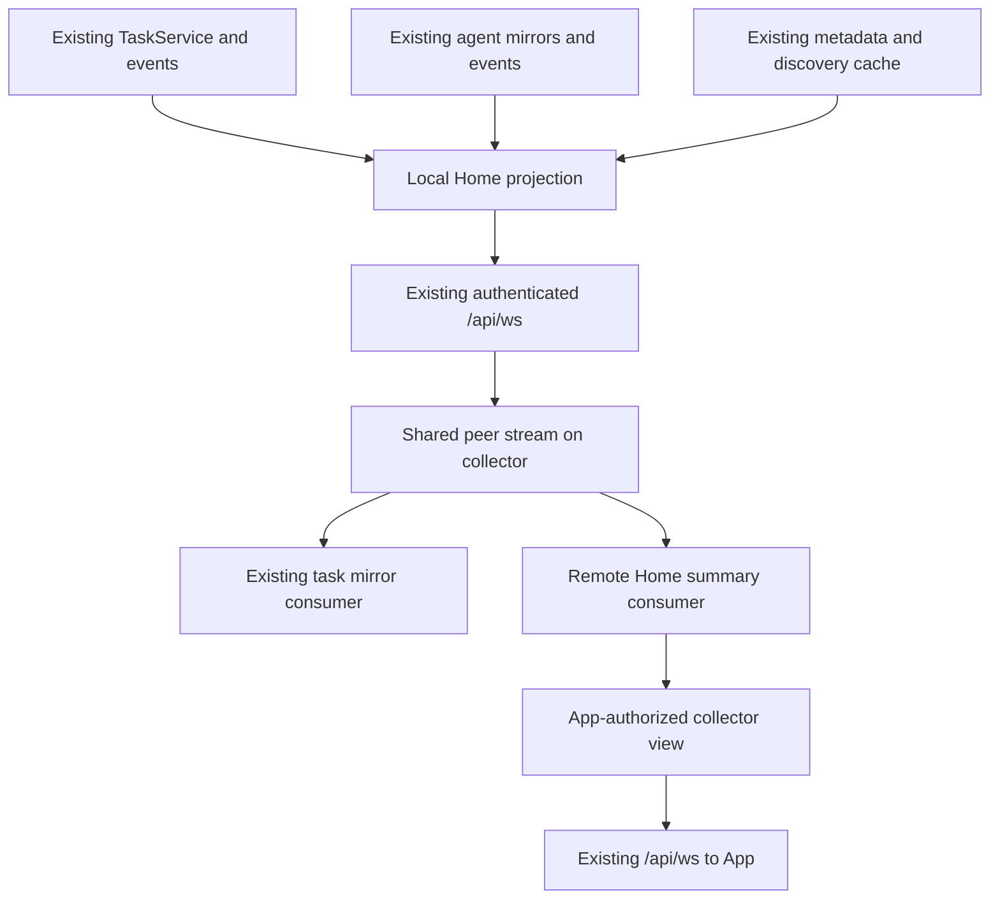

# Home summary aggregation and failover

Status: task-summary v1 implemented on the feature branch; paired-device acceptance
and release performance measurements are pending. The sections after the
implementation record describe the broader target architecture, not a claim that
every proposed optimization is already shipped.

## Implementation record: task-summary v1

The shipped protocol names are `home_task_summary_v1` and
`home_task_collector_v1`. The App subscribes through its existing `/api/ws`
connection. A subscription owns a local task projection and, when requested,
authorized peer streams. Each source sends an initial snapshot, then changed
tasks and removals with a generation and monotonic revision. Reconnect starts
a new generation and snapshot; there is no retained replay cursor in v1.
There are at most 16 remote sources and 100 tasks per source; title and progress
text are bounded. The source performs a 60-second reconciliation without sending
unchanged data. Subscriptions stop when Home is inactive or the App backgrounds.

Source-owned SQLite grants bind the approving App, exact paired reader device,
and receiving App audience. Existing encrypted transport and identity pins are
reused. A reader cannot recursively request more peers. Revocation, unpairing,
or credential replacement invalidates access. Setup requires existing Gateway
peer links; no network sweep or automatic peer pairing is performed.

The App chooses its preferred approved collector, tries approved backups after
connection failure or missing initial snapshots, and falls back to direct reads.
Partial coverage retains direct reads for uncovered sources. A single computer
has no aggregation settings, peer work or collector retry timer. Direct summary
mode still uses the same local projection and capability detection.

| Data | Current v1 path | Display owner |
| --- | --- | --- |
| Task title, state, progress, binding and child counts | Local or collected summary | Shared Home task projection |
| Default working folder | Summary under the approving App's identity | Existing default-folder store |
| Agent sessions, discovery and attention details | Existing direct reads | Existing session and attention stores |
| Stage conversation/terminal activity | Existing direct subscriptions | Existing identity-bound Stage overlay |
| Full goals, transcripts, files, commands and approvals | Existing direct detail paths | Original source Gateway |

Classic, Editorial and Stage select from the same Home task store. Full ledger
details remain in their original store. Equal task content retains object identity
so unrelated selectors do not need a new value. Collector loss preserves newer
cached task state until a direct read catches up, but stops presenting cached
progress as live. Task waiting state never manufactures an approval form; task
completion, agent busy state and pending input remain separate concepts.

Peer transport reuses `PeerClient`, handshake, framing and heartbeat code. V1
does not merge the summary stream with the pre-existing task-mirror worker's
physical socket: their independent lifetimes protect active task mirroring.
Consequently this reduces Home task fan-out, not every App connection. Sessions
and Stage activity may still maintain direct sockets. Shared peer workers,
session/attention aggregation and replay retention are future work, requiring
separate measurements and authorization design.

Loopback tests cover encrypted snapshots/deltas, two-Gateway collection,
audience isolation and revocation. App tests cover ordering, gaps, failover,
late frames, single-computer mode, detail preservation and Stage task semantics.
These tests do not substitute for real multi-computer device acceptance or
measured battery savings.

## Objective and ownership

Every capable Gateway can collect Home summaries. The App selects a preferred collector and explicitly approved alternatives. Selection belongs to each App installation: there is no fleet-wide leader election, distributed lock, or task migration. Multiple Apps may select different collectors concurrently.

The collector holds disposable read models. Original Gateways remain authoritative for tasks, sessions, and permissions. Existing terminal connections and command delivery do not move when the collector changes.

The initial scope is metadata, task summaries, bounded recent sessions, and supported attention summaries. Unsupported summary fields remain explicitly unavailable and retain existing App reads. Terminal output, transcripts, files, command execution, and approval resolution remain on their existing paths.

## Single-computer behavior is the baseline

A single paired computer uses a direct App-to-Gateway connection. The same local Home projection and optional `/api/ws` topic serve it; there is no collector hop, peer discovery sweep, peer socket, summary grant setup, standby probing, or mandatory collector preference screen. If the Gateway lacks `home_summary_v1`, keep the existing direct reads and task subscription.

Local App reads retain the existing App authentication boundary. Peer read grants are necessary only when another computer reads the source. Do not route the Gateway's own summary through `PeerClient`, create a self-peer, or count it twice in a collector view.

| Paired computers and coverage            | App path                                                | Gateway work                                                 |
| ---------------------------------------- | ------------------------------------------------------- | ------------------------------------------------------------ |
| None                                     | Existing pairing/empty state                            | No summary connection or collector timer                     |
| One, summary supported                   | Direct local summary on the server's shared socket      | Local projection only while demanded                         |
| One, older Gateway                       | Existing direct data paths                              | No new behavior required                                     |
| Multiple, no usable authorized collector | Direct per-source mode                                  | Local summaries where supported; existing fallback elsewhere |
| Multiple, collector has partial coverage | Collected covered sources plus direct uncovered sources | Only explicitly leased peer sources                          |
| Multiple, collector covers all sources   | One Home summary subscription to collector              | Local projection plus authorized remote source leases        |

Keep one canonical App source model for every mode. The provider changes, not entity keys or layout semantics. Detail consumers may share the selected server socket in direct mode; opening a terminal does not create a second Home owner.

Adding a second paired computer does not silently grant cross-computer access. Offer aggregation only once useful and authorized; preserve direct service while configuration is incomplete. Removing computers until one remains releases remote leases, stops backup checks and returns to direct mode. Removing the active collector selects an approved alternative or direct mode without losing source data ownership.

Test zero-to-one, one-to-many and many-to-one transitions, deletion during a pending switch, a single Gateway without summary capability, and a one-computer disconnect/reconnect. Acceptance for one computer requires no peer network activity or standby timers attributable to this feature. Measure direct summary costs against the current one-computer baseline; fleet improvements must not hide a single-computer regression.

## Reuse existing mechanisms

| Existing code                                                                     | Reuse                                                                                                   | Required extension or boundary                                                                                           |
| --------------------------------------------------------------------------------- | ------------------------------------------------------------------------------------------------------- | ------------------------------------------------------------------------------------------------------------------------ |
| `fleet/peers.rs`: `PeerService`, peer identities, checked transport, presence     | Peer lookup, pairing ownership, transport negotiation and authenticated contact                         | Do not treat cached peer presence as fresh Home status; do not use display `server_id` alone as authorization            |
| `fleet/peer_client.rs`: `PeerClient`, encrypted upgrade, `ClientCodec`            | One implementation of HTTP sealing, WebSocket handshake, framing, transport version pins, and heartbeat | Separate generic wire handling from `TaskFeed` decoding so summary frames are not silently discarded                     |
| `fleet/peers.rs`: `PeerSockets`                                                   | Existing per-peer worker deduplication concept and cleanup fencing                                      | Replace task-only lifetime ownership with independently reference-counted task and summary demand                        |
| `fleet/mirror.rs`: task following and reconciliation                              | Preserve owned-task filtering, remote task mapping and task recovery                                    | Feed it task events from the shared peer connection; Home disconnect must not terminate active task mirrors              |
| `agents/ws_routes.rs`: registry, codec, device checks, frame parser, send budgets | Extend `/api/ws` additively                                                                             | New summary subscription permission; existing session subscription prohibitions remain                                   |
| `tasks/service.rs`, `tasks/events.rs`                                             | Task state, existing title/progress projection and domain changes                                       | Derive summary fields; do not duplicate task state transitions                                                           |
| `agents/manager.rs` and session mirror                                            | Session identity, status and existing events                                                            | Summary projection without transcript/model-catalog payloads                                                             |
| `terminal/routes.rs` activity hub and backend port                                | Existing observation ownership and backend-neutral data                                                 | Subscribe only where required; preserve backend-specific reconciliation                                                  |
| `fleet/manifest.rs`: `FleetService`, compact projections, probe TTL               | Cached machine/discovery facts and existing compacting logic                                            | Do not regenerate a full manifest for every task event; existing count limits must not become silently exact Home totals |
| `platform/store/sqlite.rs` and domain migrations                                  | Durable authorization records                                                                           | No separate database, Redis, broker, or cache service                                                                    |
| `platform/metadata.rs` capability declarations                                    | Existing negotiation and compatibility model                                                            | Advertise only implemented summary/collector contracts                                                                   |

All paths above are under `src/`. Reuse is at the domain/service and transport boundaries. Calling local HTTP endpoints from the collector to read its own state would add serialization/authentication work and duplicate lifecycle ownership.

## Small new domain surface

Keep the feature in `src/fleet/`, with narrowly scoped modules:

- `home.rs`: immutable summary types, source identities, revisions, projection rules and explicit completeness.
- `home_service.rs`: local projection cache, event folding, initial snapshot, bounded replay and subscriber lifetime.
- `home_grants.rs`: source-approved read grants, collector audience binding, revocation and persistence through the existing SQLite worker.
- `home_collector.rs`: authorized source leases and remote summary cache; exports only requested sources to the requesting App.
- `peer_stream.rs`: shared per-peer transport worker extracted from existing task-only machinery; subscription leases and typed dispatch, not a second socket implementation.

Names are proposed, not existing interfaces. Add these modules only as their implementation slice needs them. Keep route glue in the existing fleet mounting and WebSocket composition paths; keep `AppState` as a composition root.

Task and Home events are separately authorized and dispatched even if they share one transport. The diagram does not grant task consumers permission to read Home data.

## Identity and authorization

A reachable or paired peer is not automatically allowed to collect Home summaries. Existing peer tokens intentionally cannot read arbitrary sessions, and delegated-task ownership must remain unchanged.

A source App explicitly authorizes a grant with:

- The source's authenticated Gateway peer device identity as reader.
- A bounded set of summary fields/topics.
- An audience binding to the App device identity on the intended collector.
- A grant identity and revision, with explicit revocation.

The approving App uses its existing direct authenticated source connection. Audience identifiers supplied by a collector are not proof of consent; source-side approval creates the grant. A collector must authenticate its local App and match that audience before exporting a granted source. Never forward the App's source bearer token or transport key.

This trusts the approved collector as a reader of the permitted summary. It is not end-to-end encryption against that collector. Setup must explain this boundary. Existing peer pairings receive no summary grant by default.

Persist grants through the shared SQLite infrastructure. Deny missing, mismatched, revoked, or unknown grants. Revocation stops the corresponding subscription and invalidates cached exports. Pairing removal/replacement must invalidate related grants. Authorize snapshots, replay and live events identically, and filter by audience before enqueueing data.

Collectors accept only local-source summary feeds from peers. A source must not recursively export its own collected fleet. This creates a one-hop topology and avoids loops, duplicate origins and transitive privilege expansion.

## Transport and subscription contract

Proposed capabilities: `home_summary_v1` for local source projection and `home_collector_v1` for authorized aggregation. Names remain provisional until wire tests are added. Capability support is distinct from permission and current source availability.

Extend the existing `/api/ws` protocol with bounded Home subscription/unsubscription frames. Preserve all existing task and agent-session contracts. Do not raise the WebSocket protocol version merely to add a negotiated optional topic.

A request identifies local or collected source scope, permitted topics, bounded result size, and optional resume cursors. The server derives authorized scope from the authenticated caller and grants, not from caller-provided display names. Peer callers may request only their granted local-source summaries; App callers may request an authorized collector view.

Use subscription identifiers so one socket can carry several independent consumers. Acknowledgment describes accepted scope and unsupported topics. A source that lacks a capability is not reported as offline.

Home data frames contain:

- Subscription identity and authenticated source mapping.
- Source generation, projection scope identity, and monotonic revision.
- Snapshot, upsert, deletion, freshness/status, or resync kind.
- Bounded domain payload and explicit completeness/continuation metadata.

Projection scope includes authorization revision and list/filter limits. Never resume a cursor into a differently authorized or differently filtered view. Do not rely on a globally contiguous sequence after filtering.

A collector forwards source generation/revision unchanged. Its own connection/session generation is separate. Wall-clock timestamps are for display; encryption counters protect a connection; neither substitutes for domain ordering.

### Snapshot and recovery

For v1, use bounded in-memory replay plus source snapshots, not a new durable event log. On process restart, change the source generation and require a snapshot. Persist only settings/grants; caches are rebuildable.

Serialize projection updates and snapshot watermark acquisition through one owner. Register a subscriber and acquire snapshot/cursor atomically relative to updates, then deliver queued deltas after that watermark. If the bounded buffer overflows while sending, explicitly request resync instead of silently skipping changes.

Initial source construction may combine multiple domain reads; it is not a cross-database transaction. Subscribe to existing events before constructing the projection, reconcile queued changes, and detect lag. Where a producer lacks sufficient event coverage, retain bounded reconciliation and mark freshness honestly. A monotonic projection revision must not imply stronger source consistency than exists.

A reconnect resumes only when generation, scope and retained history match. Otherwise replace that source projection from a new snapshot. Deletions must remove previous rows. Top-N membership changes include evictions, and counts report whether they are exact or bounded. Do not present a 1000-row scan as an exact unlimited fleet count.

### Shared peer worker

Today `TaskFeed::next()` discards non-task frames and `PeerSockets` owns one task follower per peer. Adding a separate summary follower to that same ownership slot would conflict; copying the follower would duplicate transport and retry logic.

Extract the existing codec/handshake/heartbeat once, then let one peer worker dispatch typed frames to task and Home consumers. Demand is keyed by peer and purpose, with independent cancellation and bounded delivery. Connect while any consumer holds a lease. Removing a Home lease must preserve task following; removing the last lease stops the worker after a short bounded grace period.

Keep legacy task-only subscriptions for older peers. Lack of Home support must not disable delegation. Task ownership checks and task resync remain independent of Home snapshot/replay. A slow Home consumer must not silently drop task events: lag must trigger that consumer's existing recovery contract.

## App selection and failover

Store preferred and approved backup collector identities in the App. Each App chooses independently; no Gateway election, leader lease, or replicated configuration is needed for v1.

Selection states: direct, connecting candidate, collecting, degraded/partially covered, and switching. A new socket being open is not enough to complete a switch.

1. Choose a healthy approved candidate that supports collection and has grants/coverage for the desired sources. Prefer user order among usable candidates.
2. Request a snapshot or valid resume for each source. Keep previous data marked with its freshness while loading.
3. Activate each source's new producer only after valid initialization. Fence callbacks by local selection epoch so an old collector cannot overwrite the new producer.
4. Retain direct reads/subscriptions for uncovered sources. Do not simultaneously count both direct and collected copies.
5. On collector failure, try approved alternatives with bounded timeouts/backoff. Use direct mode if none can cover the source.
6. Avoid immediate switchback when the preferred collector returns. Retain a working collector and reevaluate with hysteresis or at the next activation.

The collector reports its observation of each source. The App separately tracks its own connection to the collector. Loss of the latter means stale source knowledge, not proof that every source is down. A live direct route is separate evidence.

Standby collectors do not continuously collect the fleet without active demand. This makes failover require a bounded warm-up snapshot, but avoids multiplying work on every computer. Warm standby can be considered later only with measured need.

## Resource and compatibility boundaries

- Define explicit source-count, entity-count, payload-byte, queue and replay-memory limits before shipping. Use existing transport limits as ceilings, not permission for unbounded aggregation.
- Keep summary projection work proportional to changed entities. Low-frequency metadata is separately cached; do not rebuild discovery per token/task event.
- Coalesce replaceable progress; preserve pending attention and state transitions through reliable recovery.
- Refcount source observation across Apps and peer consumers. Do not start duplicate terminal activity hubs or scan every transcript.
- Continue existing endpoints and direct App mode. Negotiate each source independently in mixed-version fleets.
- Do not infer unread counts, completion, approval resolution, or total task counts when existing producers cannot establish them. Add producer coverage before claiming the field.
- No changes to command retry, terminal focus, agent launch, or approval delivery are required for this feature.

## Implementation slices and acceptance

1. **Local summary service:** domain projection, bounded snapshots/replay, capability and optional WebSocket topic. Test no-op updates, top-N eviction, generation changes, subscribe/snapshot races and buffer overflow.
2. **Peer transport extraction:** retain existing task API behavior while adding lease ownership and typed dispatch. Run existing mirror/transport tests; test task survival after Home unsubscribe, independent lag and last-consumer cleanup.
3. **Scoped grants and collector:** reuse pairing/SQLite/transport; test deny-by-default, audience isolation, revocation, identity replacement, one-hop scope and source-specific partial failure.
4. **App integration:** one resource owner feeding all three layouts, selection/failover state machine and direct fallback. Test stale old-producer events, partial coverage, duplicate task origins, source restart and capability downgrade.
5. **Acceptance and measurement:** isolated paired QA App/Gateway checks, four-computer failure scenarios and Release energy/traffic comparisons. No publication until separately requested.

Implementation must run the repository's Rust checks and the App's required validation. This document alone is not evidence that failover, security boundaries, or energy savings work.
